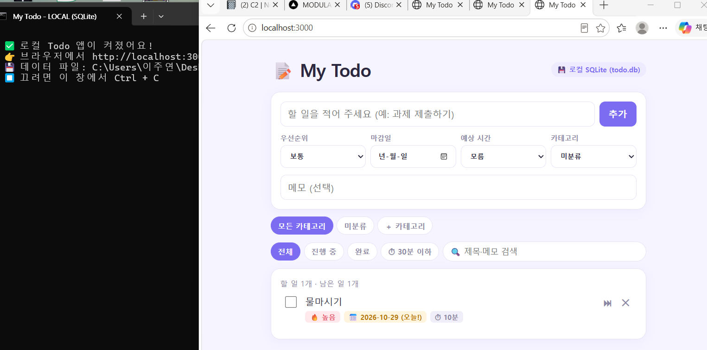
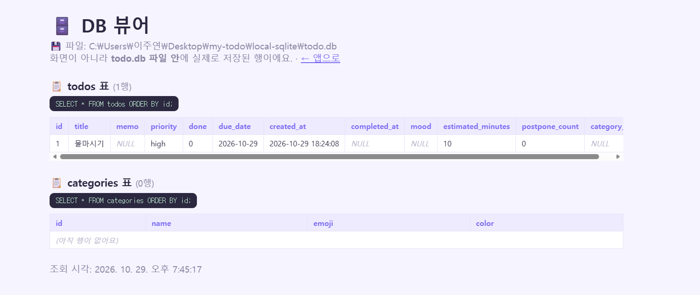
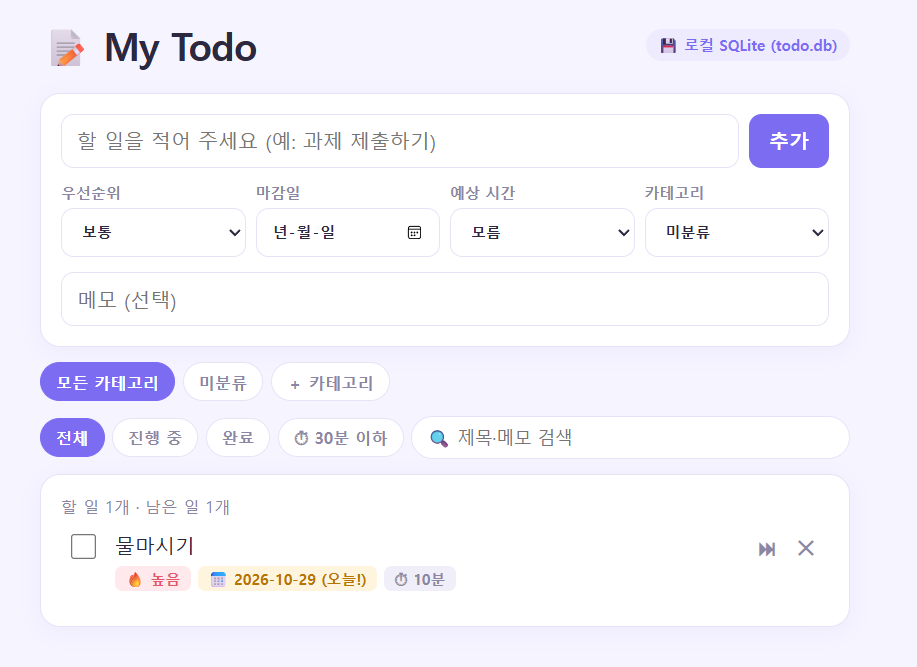
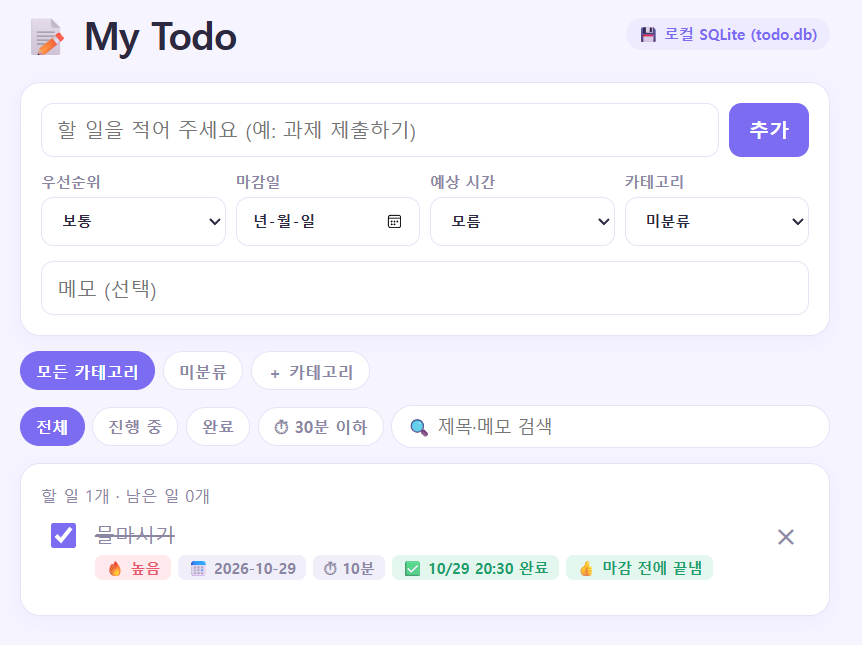
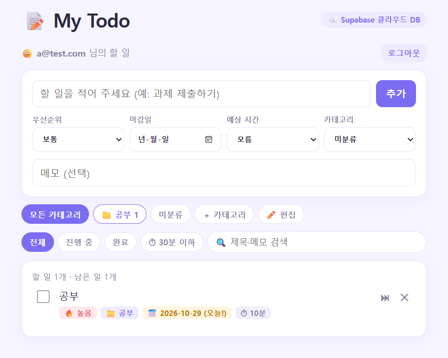
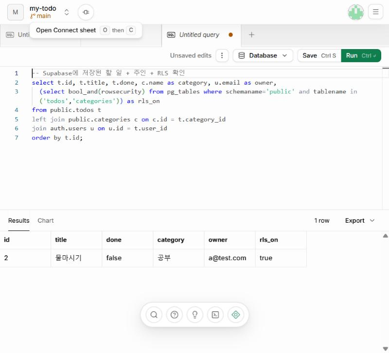
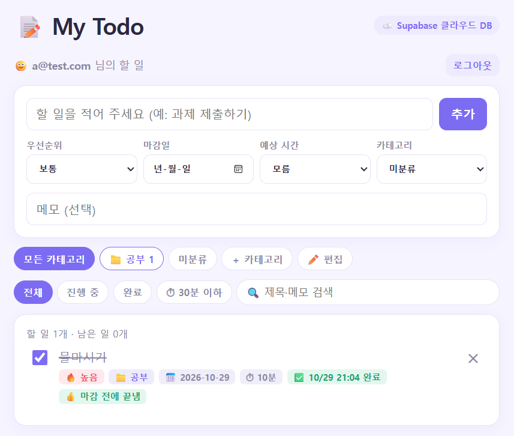
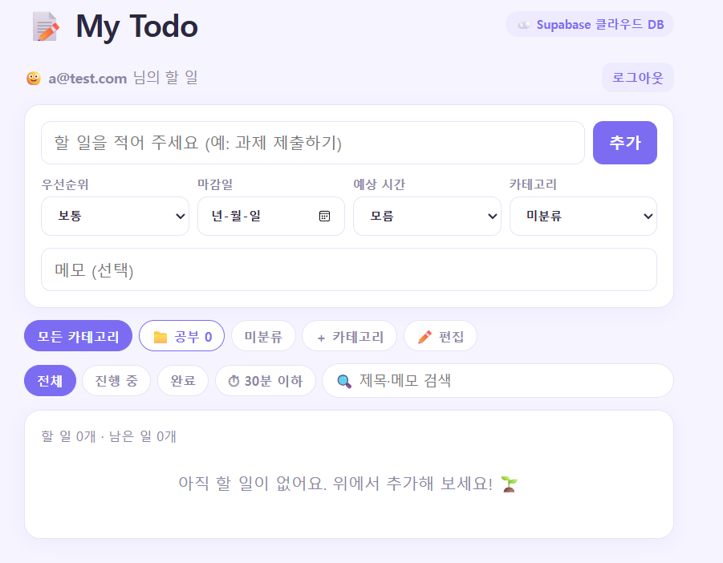
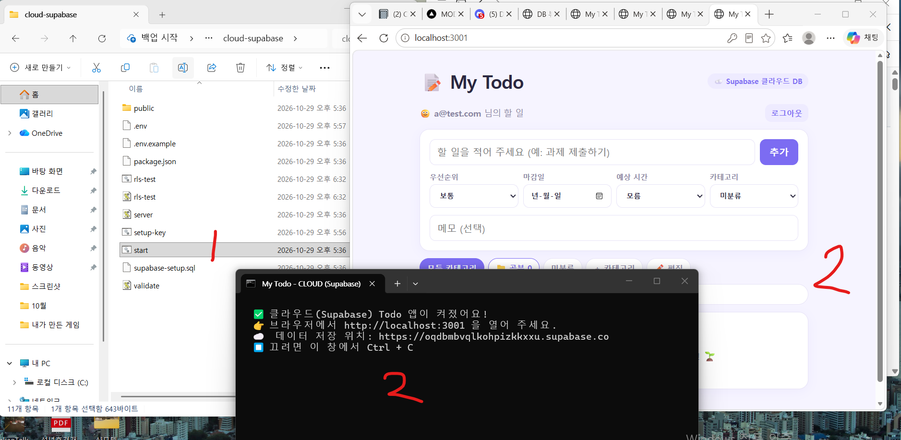
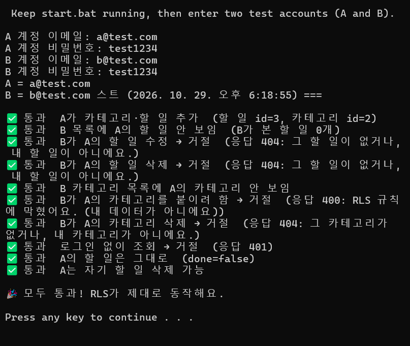

# 📝 My Todo

## 📌 과제 제출 요약

| 제출물 | 위치 |
|---|---|
| PRD 한 장 | [PRD.md](PRD.md) · DB 구조도 [docs/db-structure.png](docs/db-structure.png) |
| 작동 화면 | [캡처 폴더](캡처/) (16장, 아래에 주요 장면) |
| 코드 | 길 A [local-sqlite/](local-sqlite/) · 길 B [cloud-supabase/](cloud-supabase/) |

### ✍️ 확인 기록
- **[로컬 저장]** SQLite(`todo.db`)에 추가·완료·삭제 동작 확인. 새로고침·서버 재시작 후에도 할 일이 남음 ✅ / DB 뷰어로 `todos` 표에 행이 저장된 것 확인 ✅
- **[클라우드 전환]** 저장소를 로컬 SQLite → Supabase(클라우드 Postgres)로 전환. 화면은 백엔드 API에만 요청하고, Supabase 접속은 백엔드(`cloud-supabase/server.js`)에서만. 접속 키는 `.env`에만 두고 Git에서 제외 ✅
- **[클라우드 저장]** Supabase에서 `todos` 행 확인, 할 일마다 주인(`user_id`)이 로그인한 사용자로 자동 기록. 추가·완료·삭제 동작, 새로고침·서버 재시작 후에도 남음 ✅
- **[RLS]** `todos`·`categories`에 RLS를 켜고 `auth.uid() = user_id` 정책 설정. B 계정에서 A 계정의 할 일 조회·수정·삭제가 모두 거절되고 A의 할 일은 그대로임을 확인 → 🎉 모두 통과 ✅
- **[배포]** Render 배포 준비물 정리 완료 ([과제_체크리스트.md](과제_체크리스트.md) 3번). 실제 배포는 하지 않음

### 🖼️ 주요 작동 화면
| 로컬: 껐다 켠 뒤에도 남음 | 로컬: DB 뷰어 (`todo.db` 안의 `todos` 표) |
|---|---|
|  |  |
| **로컬: 삭제** | **로컬: 완료** |
|  |  |
| **클라우드: 로그인 후 할 일** | **Supabase: 저장된 행 + 주인 + RLS 켜짐** |
|  |  |
| **클라우드: 완료** | **클라우드: 삭제** |
|  |  |
| **클라우드: 서버 껐다 켜기** | **RLS 테스트: 모두 통과** |
|  |  |

---

# 📖 따라하기 가이드

할 일을 추가·완료·삭제하고, **완료 기분 😊, 예상 시간 ⏱, 미룬 횟수 🐢**까지 남기는 Todo 앱이에요.
- **길 A**: 내 컴퓨터의 SQLite 파일(`todo.db`)에 저장
- **길 B**: 클라우드 DB(Supabase)에 저장 + 로그인 + RLS(내 할 일만 보기)

> 👀 코드는 이미 다 만들어져 있어요. 아래 순서대로 **설치 → 더블클릭 → 확인 → 캡처**만 하면 돼요.
> 📸 표시가 있는 곳은 **과제 제출용 캡처**를 찍는 곳이에요. (윈도우: `Win + Shift + S`)

---

## 📁 폴더 구성
```
my-todo/
├─ README.md            ← 지금 이 가이드
├─ PRD.md               ← 제출물 ① (만들 것 한 장)
├─ 과제_체크리스트.md     ← 확인 기록·배포 준비물·회고 적는 곳 (제출물 ③)
├─ docs/db-structure.png ← DB 구조도
├─ .gitignore           ← .env, todo.db 는 GitHub에 안 올라가게
├─ local-sqlite/        ← 길 A (로컬)
│   ├─ start.bat        ← ⭐ 더블클릭으로 실행
│   ├─ server.js        ← 백엔드 (DB에 접근하는 유일한 파일)
│   ├─ validate.js      ← 입력값 검사
│   └─ public/index.html← 화면 (백엔드 /api 에만 요청)
└─ cloud-supabase/      ← 길 B (클라우드)
    ├─ start.bat        ← ⭐ 더블클릭으로 실행
    ├─ supabase-setup.sql ← Supabase에 붙여넣을 표 + RLS 규칙
    ├─ .env.example     ← 접속 키 넣는 양식
    ├─ rls-test.bat     ← ⭐ RLS 자동 확인 테스트
    ├─ server.js / validate.js / public/index.html
```

---

## 0단계. Node.js 설치 (딱 한 번, 5분)
1. https://nodejs.org/ko/download 에 들어가요.
2. **LTS** 버전의 **Windows 설치 프로그램(.msi)** 을 받아요.
3. 설치 파일을 실행하고 계속 **Next**만 눌러요. ("Tools for Native Modules" 체크는 안 해도 돼요)
4. 설치가 끝나면 끝! (이미 켜져 있던 창은 한 번 닫았다 열어 주세요)

✅ **확인**: 다음 단계의 `start.bat`을 더블클릭했을 때 "Node.js is not installed"가 안 뜨면 성공이에요.

> 💡 수업 자료에 나오는 `better-sqlite3`는 설치할 때 빌드 에러가 잘 나요.
> 이 앱은 **Node에 기본으로 들어 있는 SQLite**를 써서 `npm install`이 필요 없어요.

---

## 1단계. 길 A - 내 컴퓨터에서 돌리기
1. `local-sqlite` 폴더 → **`start.bat` 더블클릭** (또는 PowerShell에서 `cd local-sqlite` → `node server.js`)
   - 검은 창(서버)이 뜨고, 브라우저에 `http://localhost:3000`이 자동으로 열려요.
   - ⚠️ 검은 창을 닫으면 앱이 꺼져요. 쓰는 동안은 켜 두세요.
   - "Windows의 PC 보호" 창이 뜨면 → **추가 정보 → 실행**
2. 앱에서 해 보기
   - `＋ 카테고리`로 📚 공부, 🏠 생활 같은 카테고리 만들기
   - 할 일 3~4개 추가 (우선순위·마감일·예상 시간·카테고리·메모 골고루)
   - 하나는 ⏭ 버튼을 3번 눌러서 🐢 **만성 미룸러** 만들기
   - 하나는 체크 → 기분 😊 고르기 (완료)
   - 하나는 ✕ 삭제
3. 📸 **캡처 A-1**: 할 일이 들어 있는 화면

✅ **확인 (껐다 켜도 남는지)**
- 브라우저 **새로고침(F5)** → 그대로면 OK
- 검은 창을 **닫고** → `start.bat`을 **다시 더블클릭** → 그대로면 OK
- 📸 **캡처 A-2**: 다시 켠 뒤의 화면 (검은 창도 같이 보이면 더 좋아요)

✅ **확인 (DB 안을 직접 보기)**
1. https://sqlitebrowser.org/dl/ 에서 **DB Browser for SQLite** 설치
2. 실행 → **데이터베이스 열기** → `local-sqlite/todo.db` 선택
3. **데이터 보기** 탭 → 테이블에서 `todos` 선택 → 내가 넣은 할 일이 줄(행)로 보여요!
   - `mood` 칸에 😊, `postpone_count` 칸에 3, `completed_at`에 완료 시각이 있는지 보기
4. 📸 **캡처 A-3**: DB Browser의 todos 표 화면
   - 💡 설치가 어렵다면: 앱을 켠 채로 **http://localhost:3000/db** 에 들어가면 `todo.db` 안의 표를 SQL로 바로 보여 주는 **내장 DB 뷰어**가 열려요

> 🤓 `server.js` 맨 위의 `CREATE TABLE`이 표를 만드는 SQL이고,
> `listTodos` 함수 안의 `SELECT ... FROM todos ... WHERE ...`가 목록을 꺼내는 SQL이에요. (회고 sec_5에 쓰기 좋아요)

---

## 2단계. 길 B - Supabase 준비 (10분)
### 2-1. 프로젝트 만들기
1. https://supabase.com → **Start your project** → GitHub 또는 이메일로 가입
2. **New project** → 이름 `my-todo`, Database Password는 아무거나 길게 (메모해 두기), Region은 **Northeast Asia (Seoul)**
3. 1~2분 기다리면 프로젝트가 만들어져요.

### 2-2. 표 + RLS 만들기
1. 왼쪽 메뉴 **SQL Editor** → 새 쿼리
2. `cloud-supabase/supabase-setup.sql` 파일을 메모장으로 열어 **전부 복사 → 붙여넣기 → Run**
3. 아래 결과에 `categories | true`, `todos | true`가 나오면 성공이에요! (RLS 켜짐)
   - "destructive operation" 경고가 뜨면 → 실행해도 괜찮아요 (처음엔 지울 게 없어요)
4. 📸 **캡처 B-1**: Run 결과 화면 (rowsecurity = true)
5. (확인) 왼쪽 **Table Editor** → `todos`, `categories` 표가 생겼고 **RLS enabled** 표시가 있어요.

### 2-3. 테스트를 쉽게: 이메일 인증 끄기
가입할 때마다 인증 메일을 누르기 번거로우니 꺼 둬요.
- 왼쪽 **Authentication** → **Sign In / Providers** (또는 Providers) → **Email** → **Confirm email 끄기** → Save
- (끄기 싫다면) **Authentication → Users → Add user → Create new user**에서 **Auto Confirm User** 체크하고 계정을 만들어도 돼요.

### 2-4. 접속 키 복사 → `.env`에 넣기
1. `cloud-supabase` 폴더 → **`start.bat` 더블클릭**
   - 처음엔 `.env` 파일이 자동으로 생기고 **메모장이 열려요.**
2. Supabase 대시보드 위쪽 **Connect** 버튼 (또는 **Project Settings → API Keys / Data API**)에서 복사
   - `SUPABASE_URL=` 뒤에 **Project URL** (예: `https://abcd1234.supabase.co`)
   - `SUPABASE_KEY=` 뒤에 **Publishable key** (`sb_publishable_...`) 또는 **anon** key
   - ⚠️ **secret / service_role 키는 절대 X!** (넣으면 앱이 실행을 거부해요)
3. 메모장 **저장(Ctrl+S)** → 닫기

> 🔐 키는 `.env`에만 있고, 이 파일은 `.gitignore`에 들어 있어서 GitHub에 안 올라가요.
> 화면 코드(index.html)에는 Supabase 주소도 키도 없어요. → "프론트는 백엔드에만, 백엔드가 DB에"

---

## 3단계. 길 B - 클라우드로 돌리기
1. `cloud-supabase/start.bat` **다시 더블클릭** → `http://localhost:3001` 열림 (화면 오른쪽 위에 ☁️ Supabase 표시)
2. 이메일/비밀번호(6자 이상)로 **회원가입** → 자동 로그인
3. 길 A에서 한 것처럼 카테고리·할 일 추가, ⏭ 미루기, 완료(기분), 삭제
4. 📸 **캡처 B-2**: 앱 화면

✅ **확인 (클라우드에 진짜 저장됐는지)**
- Supabase **Table Editor → todos** → 방금 넣은 할 일이 줄로 보여요. `user_id` 칸에 내 계정 번호가 자동으로 들어가 있어요.
- 📸 **캡처 B-3**: Table Editor 화면
- 새로고침(F5), 검은 창 닫고 다시 켜기 → 그대로면 OK → 📸 **캡처 B-4**

---

## 4단계. RLS 확인 - "다른 사람 할 일은 못 본다"
### 방법 1. 눈으로 확인
1. 앱에서 **로그아웃** → 다른 이메일로 **회원가입** (B 계정)
2. A 계정의 할 일이 **하나도 안 보이면** 성공! → 📸 **캡처 B-5**
3. 다시 A로 로그인하면 내 할 일이 그대로 있어요.

### 방법 2. 자동 테스트 (수정·삭제 공격까지 확인)
화면에는 남의 할 일 버튼이 없어서 "수정·삭제 시도"는 직접 해 보기 어려워요. 그래서 테스트 스크립트를 준비했어요.
1. `start.bat`(길 B)은 켜 둔 채로 `cloud-supabase/rls-test.bat` **더블클릭**
2. 아무것도 입력하지 않아도 돼요. 테스트용 계정 2개(`rls-a@test.com`, `rls-b@test.com`)를 알아서 만들어 확인해요
3. 이런 결과가 나오면 성공 → 📸 **캡처 B-6** (RLS 확인 기록!)
```
✅ 통과  A가 카테고리·할 일 추가
✅ 통과  B 목록에 A의 할 일 안 보임
✅ 통과  B가 A의 할 일 수정 → 거절
✅ 통과  B가 A의 할 일 삭제 → 거절
✅ 통과  B 카테고리 목록에 A의 카테고리 안 보임
✅ 통과  B가 A의 카테고리를 붙이려 함 → 거절
✅ 통과  B가 A의 카테고리 삭제 → 거절
✅ 통과  로그인 없이 조회 → 거절
✅ 통과  A의 할 일은 그대로
🎉 모두 통과! RLS가 제대로 동작해요.
```

> 🤓 **어떻게 막히나요?** 백엔드는 "로그인한 사람의 토큰"을 그대로 Supabase에 넘겨요.
> DB의 RLS 규칙 `auth.uid() = user_id`가 "토큰 주인 = 행 주인"인 줄만 보여 주고 바꾸게 해 줘요.
> 그래서 B가 A의 할 일 번호를 알아도 **0줄이 바뀌고 → 거절**돼요.

---

## 5단계. 제출하기 (마감 11/5 23:59)
`과제_체크리스트.md`를 채우고, 아래 중 편한 방법으로 제출해요.

**방법 1. 구글 드라이브 (쉬움)**
1. `my-todo` 폴더를 복사한 뒤 **`cloud-supabase/.env` 파일은 지우기** (⚠️ 키가 들어 있어요)
2. 캡처들을 `docs/` 폴더에 넣기
3. 구글 드라이브에 폴더째 업로드 → **공유 → 링크가 있는 모든 사용자** → 링크 제출

**방법 2. GitHub**
- `.gitignore`가 있어서 `.env`와 `todo.db`는 자동으로 빠져요.
- GitHub에 올리는 건 Claude에게 "my-todo 폴더를 GitHub에 올려 줘"라고 부탁해도 돼요.

---

## 🆘 막혔을 때
| 증상 | 해결 |
|---|---|
| `Node.js is not installed` | 0단계 다시. 설치 후 창 닫았다 열기 |
| `Node.js is too old` | nodejs.org에서 최신 **LTS** 다시 설치 |
| `EADDRINUSE` / 포트 사용 중 | 이미 켜진 검은 창이 있어요. 그 창을 닫고 다시 실행 |
| 브라우저에 "서버가 꺼져 있어요" | 검은 창(start.bat)이 꺼졌어요. 다시 더블클릭 |
| `.env 파일에 ... 넣어 주세요` | 2-4단계. 값 앞뒤에 따옴표·띄어쓰기 없는지 확인 |
| `SUPABASE_KEY가 맞지 않아요` | Publishable/anon 키를 다시 복사 (끝까지 다 복사됐는지) |
| `Supabase에 표가 없어요` | 2-2단계 SQL을 Run 했는지 확인 |
| `이메일 인증이 아직 안 됐어요` | 2-3단계 (Confirm email 끄기) |
| 그 외 에러 | 검은 창의 에러 문구를 **그대로 복사해서 Claude에게** 보여 주세요 |
